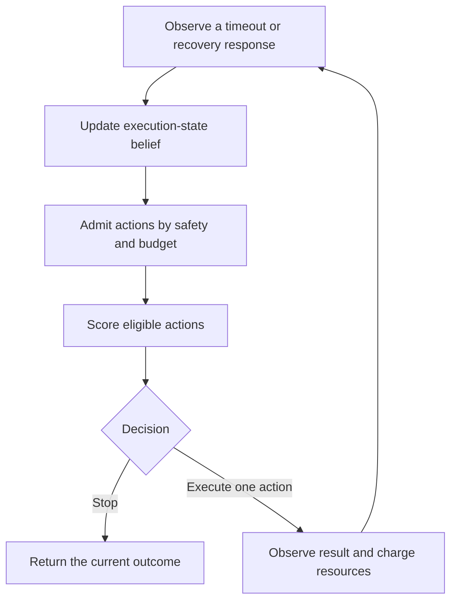

# SURE — Semantics-Constrained Uncertainty-Aware Recovery Engine

SURE is a research prototype for recovering from ambiguous HTTP timeouts. It compares a one-step greedy policy with a two-step partially observable Markov decision process (POMDP) planner. Both policies use the same model, safety rules, deadline, and recovery-call budget. The standalone implementation lives on the `rash` branch, with a JSON decision contract for future Ballerina integration.

**Research question:** Under which fault conditions and budgets does planning one action further ahead improve correct, confirmed, on-time recovery, and what latency or recovery traffic does that improvement cost?

## Contents

- [Motivating example](#motivating-example)
- [How the planner works](#how-the-planner-works)
- [Policies and safety constraints](#policies-and-safety-constraints)
- [Run the prototype](#run-the-prototype)
- [Experimental design](#experimental-design)
- [Read the results](#read-the-results)
- [Ballerina integration contract](#ballerina-integration-contract)
- [Repository map](#repository-map)
- [Verification and limitations](#verification-and-limitations)

## Motivating example

A client sends a non-idempotent payment request and times out at 400 ms. With a 1,000 ms end-to-end deadline, it has 600 ms left. The same timeout can correspond to a dropped request, a payment that is still processing, or a payment that committed before the reply was lost. The recovery policy sees the timeout and remaining time. The simulator retains the actual execution state for evaluation.

With one recovery call left, checking status immediately can return `pending` and spend the last call. Waiting can give an in-flight payment time to commit, making a later check more useful. If the payment had already committed, an immediate query could be faster. Lookahead evaluates that trade-off before it sees the actual state.

The **per-attempt timeout** limits how long the client waits for one response. The **end-to-end deadline** limits the entire logical operation, including recovery. The experiment varies the overall budget and uses fixed simulated action durations so the comparison isolates planning depth.

## How the planner works



The hidden payment state is one of `unstarted`, `processing`, or `completed`. A **belief** is a probability distribution over these three states. The model gives a joint probability of the next state and observation for each action and current state. Candidate actions in this prototype have fixed durations. The joint model allows a payment to complete while a query is in flight and allows a completed payment to remain unconfirmed when the query times out.

After observing a result, the belief update groups the outcome probabilities for that result by next state and normalizes them. For example, confirmation shifts belief to `completed` under the simulator’s trusted observation model. An unsuccessful query can leave positive probability on several states.

For an admissible action $a$, the one-step utility is:

$$
U_1(b,a)=P(\text{immediate confirmation}\mid b,a)-c_{\mathrm{call}}n(a)-c_{\mathrm{time}}t(a).
$$

Here $n(a)$ is the recovery calls charged by the action, $t(a)$ is its duration in milliseconds, and $c_{\mathrm{call}}$ and $c_{\mathrm{time}}$ are the configured costs. Admission ensures the action can fit the remaining budget. Immediate confirmation probability is the belief-weighted sum of each hidden state’s conditional confirmation probability. Waiting has zero immediate confirmation reward and consumes only time. Stopping has zero utility and wins ties against taking action in the one-step policy.

The depth-2 planner adds the expected value of an eligible follow-up for each nonterminal observation:

$$
U_2(b,a)=U_1(b,a)+\sum_{o\ne\mathrm{confirmed}} P(o\mid b,a)\max_{a'\in A_{\mathrm{after}}(o)} U_1(b_o,a').
$$

The posterior $b_o$ and the remaining time and calls determine the next decision. The follow-up can always stop with incremental utility zero. A confirmed branch ends without an additional reward. The planner returns one first action and recomputes after the result.

### Hand check

The regression test uses the same illustrative model for both policies. With **600 ms and one call left**, an immediate status query has utility **0.189**. Waiting 200 ms and then querying has utility **0.216**, so greedy queries and lookahead waits. When only **250 ms** remain, a 200 ms wait followed by a 120 ms query is infeasible and lookahead queries immediately. These values verify the policy math on a stipulated fixture. The benchmark uses a separate parameterized outcome model.

## Policies and safety constraints

| Policy | Selection rule |
|---|---|
| `greedy` | Chooses the eligible action with the greatest positive immediate utility. |
| `lookahead` | Scores the first action and the best eligible one-step follow-up for each possible observation. |
| `fixed_status` | Checks status as soon as the action is eligible. |
| `fixed_backoff` | Prefers safe failover when eligible and otherwise checks status. Waits before the first network action when the wait and action both fit. |

The shared action filter runs before scoring. The benchmark checks admission again before executing the selected action.

| Action | Time reserved | Recovery calls | Semantic requirement |
|---|---:|---:|---|
| `stop` | 0 ms | 0 | Always available. |
| `wait` | 200 ms | 0 | Requires enough remaining time. |
| `reconcile` | 120 ms | 1 | Queries status without repeating the payment. |
| `retry` | 150 ms | 1 | Requires authoritative no-commit evidence or verified same-request deduplication covering the primary. |
| `failover` | 180 ms | 1 | Requires authoritative no-commit evidence or verified same-request deduplication covering the backup. |

Only `stop` is admitted after confirmed completion or deadline expiry. A timeout, pending response, missing record, or high probability of non-execution leaves the outcome ambiguous. Verified deduplication must cover the same logical request and the selected destination. An ambiguous repeat can make previous no-commit evidence stale. A decision layer must preserve this rule across calls.

## Run the prototype

Run from the repository root. Python **3.10 or newer** is required. The SURE simulation, tests, and analyzer use the standard library.

**PowerShell**

```powershell
git fetch origin
git switch rash
git pull --ff-only origin rash
py -3 -m unittest discover -s tests -p "test_sure_*.py" -v
py -3 -m sure_research.benchmark --seed 42 --episodes-per-cell 100 --out sure-results/run-42
py -3 -m sure_research.analyze sure-results/run-42 --out sure-results/run-42-analysis
```

**Linux, macOS, or WSL**

```bash
git fetch origin
git switch rash
git pull --ff-only origin rash
python3 -m unittest discover -s tests -p 'test_sure_*.py' -v
python3 -m sure_research.benchmark --seed 42 --episodes-per-cell 100 --out sure-results/run-42
python3 -m sure_research.analyze sure-results/run-42 --out sure-results/run-42-analysis
```

Expect `Ran 20 tests` and `OK`. With 100 episodes per cell, the benchmark writes **6,400 policy runs for 1,600 matched cases**. For a quick check, pass `--episodes-per-cell 2`. That produces 32 cases and 128 policy runs. Both commands require **new** output directories. For example, use `run-43` and `run-43-analysis` for a run with seed 43. Preserve `config.json` and the Git commit with any reported results.

## Experimental design

The experiment starts from a synthetic population that has already timed out at 400 ms. The four policies start each matched case with the same hidden initial state, original commit time, recovery budget, and per-action random draws. The two planners also share the same belief, transition/observation model, and costs. They receive observations instead of the simulator’s execution ledger.

| Factor | Values |
|---|---|
| Time remaining after the initial timeout | 250 or 600 ms |
| Verified shared deduplication | Absent, or covers primary and backup for this request |
| Status endpoint availability | 0.25 or 0.90 |
| Primary retry availability | 0.30 or 0.90 |
| Backup failover availability | 0.90 throughout |
| Recovery-call budget | One network action |
| Initial belief | `(12/44, 20/44, 12/44)` for unstarted, processing, completed |
| Residual processing time | Exponential model with a 220 ms mean, rounded up in the simulator |
| Utility costs | 0.05 per recovery call and 0.001 per millisecond |
| Post-deadline ledger audit | 1,000 ms grace period |

The four crossed factors produce **16 conditions**. The simulator samples whether each timed-out payment was dropped, still processing, or completed with a lost response. It records each executed action, its virtual timing, and the final observation. The ledger audit counts effects independently of what the client reported. A late or unconfirmed effect can still matter when evaluating duplicates.

## Read the results

| Output | What to look for |
|---|---|
| `runs.csv` | One row per policy and case. Inspect timestamps, observation history, and action trace. |
| `summary.csv` | Policy totals and averages, including confirmed completion, unresolved requests, duplicates, recovery calls, retries, and virtual latency. |
| `by_condition.csv` | The same metrics broken down by the four factors. |
| `config.json` | Seed, parameters, action durations, and utility weights. |
| `paired_overall.csv` | Lookahead-only wins, comparator-only wins, ties, and paired differences for each comparator. |
| `paired_by_condition.csv` | The same paired comparison within each condition. |

**On-time confirmed success** counts a request only if the client receives confirmation by the end-to-end deadline and the simulator finds exactly one effect at audit. Its denominator is all cases in the synthetic initial-timeout population. **Unresolved** means that the client never received confirmation. **Latency** is end-to-end virtual elapsed time, including the initial 400 ms. **Duplicate effects** counts extra effects beyond the first.

Start with the `greedy` comparator in `paired_overall.csv`. `confirmed_difference_pp` is lookahead minus comparator in **percentage points**. The exact McNemar calculation uses the cases where only one policy succeeded. The mean latency, retries, and call differences are also lookahead minus comparator. A positive confirmation difference favors lookahead on success, while a positive latency difference means lookahead took longer. Read the action traces for cases where the decisions and outcomes diverge. Treat condition-level tests as exploratory and use a fresh design or seeds for follow-up validation.

## Ballerina integration contract

`python -m sure_research.planner_api` reads one JSON request from standard input and returns one JSON response. The same entry point is available in Python as `decide(request)`. This is the version 1 decision boundary for a future Ballerina client.

```json
{
  "version": 1,
  "request_id": "payment-1",
  "policy": "lookahead",
  "evidence": "ambiguous",
  "remaining_ms": 600,
  "remaining_calls": 1,
  "belief": {"unstarted": 0.25, "processing": 0.5, "completed": 0.25},
  "availability": {"reconcile": 0.9, "retry": 0.9, "failover": 0.9},
  "verified_deduplication_endpoints": []
}
```

Save the example as `planner-request.json` to test the interface.

```powershell
Get-Content -Raw planner-request.json | py -3 -m sure_research.planner_api
```

```bash
python3 -m sure_research.planner_api < planner-request.json
```

The reply includes the protocol version, request ID, selected action, utility score, reserved milliseconds, and recovery calls to charge. Invalid input returns an error with action `stop` and process exit status 2.

The trusted client owns the request lifecycle, monotonic deadline, evidence classification, and dispatch. It supplies the current belief, verifies the same-request deduplication contract, checks the planner response and remaining budget, and rechecks semantic admission immediately before execution. A timeout, pending result, or missing record maps to `ambiguous`. Only authoritative service evidence can establish `confirmed` or `no_prior_attempt_can_commit`. If the decision interface is invalid or unavailable, the client should stop recovery and report the current outcome.

## Repository map

| File | Responsibility |
|---|---|
| [simulator.py](simulator.py) | Payment event timelines and the initial client-visible outcome. |
| [admission.py](admission.py) | Evidence, request-scoped destination guarantees, and action admission. |
| [greedy.py](greedy.py) | One-step scoring and action selection. |
| [lookahead.py](lookahead.py) | Joint outcome model, observation-conditioned posterior, and depth-2 planning. |
| [benchmark.py](benchmark.py) | Seeded cases, policies, simulated execution, and ledger-backed metrics. |
| [analyze.py](analyze.py) | Validated pairing and overall and condition-level comparisons. |
| [planner_api.py](planner_api.py) | Versioned JSON input validation and action recommendation. |
| [SURE tests](../tests/) | Simulator, safety, policy, reproducibility, and workflow checks. |

## Verification and limitations

The standalone suite covers ambiguous completion, late commits, deadline and call limits, deduplication scope, greedy score calculations, posterior updates, stale evidence, paired reproducibility, and JSON input handling. Benchmark and analysis commands have been exercised through the full 1,600-case workflow.

The benchmark uses virtual time, fixed action durations, stipulated availability, a matched synthetic model, and idealized deduplication. Its latency and duplicate counts describe this simulator. Production deduplication, real HTTP timing, Ballerina dispatch overhead, and runtime cancellation require separate validation. The JSON interface is executable, with the Ballerina client adapter and integration into the shared team engine remaining future work. Claims about estimator performance, real-world improvement, or algorithmic novelty require further evidence.
